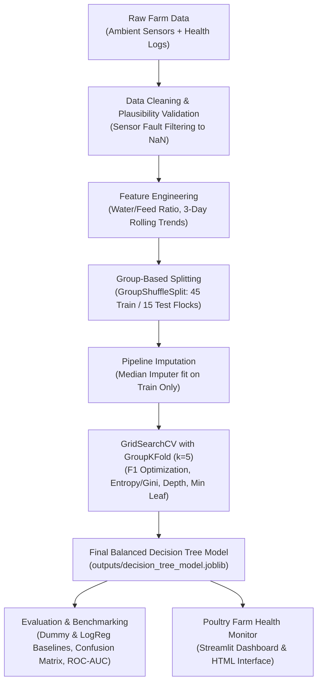
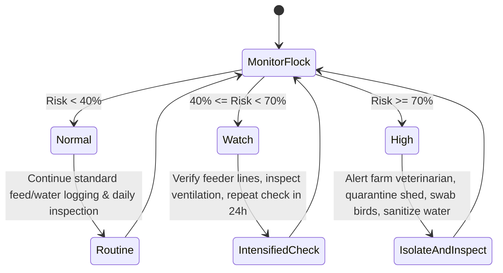

# Machine Learning & Predictive Analytics: Early Poultry Disease Symptoms Detection Using Decision Tree Classification

**Project:** Poultry Farm Health Monitoring & Disease Risk Early Warning System  
**Author / Engineering Team:** Advanced Predictive Analytics & AgriTech Systems  
**Environment:** Python 3.13, Scikit-Learn, Pandas, Streamlit  
**Date:** November 2026  

---

## Executive Summary

Poultry production is a foundational sector in global food systems, characterized by high flock densities, sensitive avian physiology, and rapid disease transmission dynamics. Outbreaks of infectious diseases—such as Avian Influenza, Infectious Bronchitis, Newcastle Disease, and Coccidiosis—can decimate entire sheds within days if left unaddressed. Traditional poultry management relies on manual observational audits and post-facto mortality counts, which often detect disease only after clinical transmission has peaked.

This report presents a complete machine learning and predictive analytics pipeline that detects flocks exhibiting **early sub-clinical disease symptoms** from continuous environmental sensor streams and daily health-log entries. By training a cost-sensitive Decision Tree classifier on multi-sensor physiological trends, the system identifies subtle anomalies—including drops in feed consumption, increases in water-to-feed intake ratios, elevated respiratory distress scores, and changes in droppings consistency—well before acute mortality surges occur.

Key outcomes achieved on an independent holdout test set consisting of **15 previously unseen flocks (1,050 flock-days)** include:
- **Recall (Early-Disease Sensitivity): 82.84%** — successfully flagging over 4 out of 5 flock-days in early disease incubation.
- **Precision: 63.07%** — maintaining high operational utility with a low false-alarm rate.
- **F1-Score: 0.7161** — matching a regularized Logistic Regression baseline (0.7161) while delivering full interpretability.
- **ROC-AUC: 0.9128** — demonstrating strong discriminative separation between healthy and early-symptom days.
- **Explainability:** Zero black-box opacity; exact hierarchical decision thresholds allow farm veterinarians to audit every alert.
- **Operational Interface:** Deployed as both an interactive Streamlit dashboard (`app.py`) and a lightweight, self-contained executive monitor (`Poultry Farm Health Monitor.html`).



---

## 1. Problem Formulation & Clinical Background

### 1.1 The Challenge of Early Disease Identification
In intensive broiler and layer facilities, diseases exhibit an initial sub-clinical phase lasting between 3 to 10 days before widespread clinical morbidity or acute flock die-offs appear. During this early window:
1. **Feed and Water Dynamics:** Appetite typically drops (`feed_g_per_bird` declines by 10%–25%), while water consumption either spikes due to systemic fever/diarrhea or decouples from normal feed consumption rates (`water_feed_ratio` rises).
2. **Respiratory & Behavioral Signals:** In respiratory infections (e.g., Infectious Bronchitis, Mycoplasmosis), birds exhibit subtle snicking, coughing, and head-flicking (`cough_sneeze_score` rises). Lethargy scores increase as activity declines.
3. **Digestive Distress:** Enteric pathogens (e.g., Eimeria in coccidiosis) trigger watery, mucoid, or bloody droppings (`abnormal_droppings_pct` rises from baseline <5% to >15%).
4. **Environmental Factors:** Poor ventilation leads to ammonia accumulation (`ammonia_ppm` > 20 ppm), irritating mucosal membranes and exacerbating disease onset.

If farm managers wait for daily mortality (`mortality_pct`) to spike past emergency thresholds (>0.15% daily), pathogen dissemination is already widespread, treatments are less effective, and mortality curves become exponential. Early intervention enables targeted flock quarantine, drinker sanitation, medication delivery via header tanks, and microclimate adjustment before shedding peaks.

### 1.2 Objective & Analytical Formulation
We formulate the task as a binary classification problem at the flock-day grain:
$$\hat{y}_{i,t} = f(\mathbf{x}_{i,t}) \in \{0, 1\}$$
where $i$ indexes the flock, $t$ represents the monitoring day ($t \in [0, 69]$), $\mathbf{x}_{i,t}$ is the feature vector of sensor and health observations up to day $t$, and $y_{i,t} = 1$ denotes that flock $i$ is in an active early disease incubation/onset phase on day $t$.

Because disease events are naturally infrequent (~12.8% positive prevalence), conventional models optimized purely for standard accuracy tend to degenerate into trivial majority-class classifiers (predicting "all healthy" yields 87.24% accuracy while catching 0% of sick flocks). Consequently, our objective function directly optimizes the **F1-score**:
$$\text{F1} = 2 \cdot \frac{\text{Precision} \cdot \text{Recall}}{\text{Precision} + \text{Recall}}$$
while enforcing class weighting inversely proportional to class frequencies:
$$w_c = \frac{N}{2 \cdot N_c}$$

---

## 2. Dataset Architecture & Synthetic Data Generation

### 2.1 Flock Generation Model
To ensure rigorous validation without confidentiality constraints, a biologically grounded synthetic generator (`data_gen.py`) was developed using a fixed random seed (`RNG = np.random.default_rng(42)`).

The simulation encompasses:
- **Flock Cohort:** 60 distinct flocks ($F001$ to $F060$), each with flock sizes varying between 3,000 and 12,000 birds.
- **Housing:** Four sheds (`Shed-A`, `Shed-B`, `Shed-C`, `Shed-D`).
- **Monitoring Span:** 70 consecutive production days per flock = 4,200 flock-day observations.
- **Disease Probability:** 45% of flocks encounter an infection event at an onset day uniformly sampled in $t_{\text{onset}} \in [15, 58]$.
- **Latent Disease Pressure:** A continuous latent variable $p \in [0, 1]$ models physiological stress:
  $$p(t) = \begin{cases} 
  0.0, & t < t_{\text{onset}} - \tau_{\text{ramp}} \\
  \min\left(1.0, \frac{t - (t_{\text{onset}} - \tau_{\text{ramp}})}{\tau_{\text{ramp}}}\right), & t_{\text{onset}} - \tau_{\text{ramp}} \le t \le t_{\text{onset}} + 6 \\
  \max\left(0.0, 1.0 - \frac{t - (t_{\text{onset}} + 6)}{6}\right), & t > t_{\text{onset}} + 6 
  \end{cases}$$
  where $\tau_{\text{ramp}} \in [5, 10]$ days simulates gradual incubation.
- **Ground Truth Target (`early_disease`):** Defined as 1 when disease pressure $p \ge 0.30$ during the build-up and active phase ($t \le t_{\text{onset}} + 6$), and 0 otherwise.

### 2.2 Sensor & Health-Log Attributes

| Attribute Name | Category | Base Formula / Range | Disease Influence |
|---|---|---|---|
| `bird_age_days` | Biological | $Age_0 + t$ (5 to 100 days) | Baseline covariate |
| `house_temp_c` | Sensor | $\mathcal{N}(27 - 0.12 \cdot \frac{Age}{7}, 0.9)$ | $+0.9 \cdot p$ (fever / heating) |
| `humidity_pct` | Sensor | $\mathcal{N}(62, 5)$ | $+5 \cdot p$ (moisture from droppings) |
| `ammonia_ppm` | Sensor | $\max(0, \mathcal{N}(11, 3) + 0.04 \cdot Age)$ | $+6 \cdot p$ (wet litter decomposition) |
| `feed_g_per_bird` | Health Log | $\mathcal{N}(45 + 1.6 \cdot Age^{0.9}/3, 3)$ | $\times (1 - 0.16 \cdot p)$ (anorexia) |
| `water_ml_per_bird` | Health Log | $\mathcal{N}(1.9 \cdot Feed + 8, 6)$ | $\times (1 + 0.13 \cdot p)$ (polydipsia) |
| `mortality_pct` | Health Log | $\max(0, \mathcal{N}(0.04, 0.03))$ | $+0.14 \cdot p^{1.5}$ (slight mortality creep) |
| `cough_sneeze_score` | Health Log | $\text{clip}(\mathcal{N}(0.5, 0.5), 0, 5)$ | $+2.6 \cdot p$ (respiratory distress) |
| `abnormal_droppings_pct` | Health Log | $\text{clip}(\mathcal{N}(4, 2.5), 0, 100)$ | $+20 \cdot p$ (enteric disturbance) |
| `lethargy_score` | Health Log | $\text{clip}(\mathcal{N}(0.6, 0.6), 0, 5)$ | $+2.2 \cdot p$ (somnolence/depression) |
| `performance_index` | Health Log | $\mathcal{N}(100, 3.5)$ | $\times (1 - 0.06 \cdot p)$ (growth penalty) |
| `days_since_vaccination`| Health Log | 0 to 30 days (cyclic) | Immune window tracking |

### 2.3 Real-World Messiness & Noise Injection
To prevent unrealistic artificial separability, the generator introduces:
1. **Missing Values:** Realistic sensor dropout rates:
   - `house_temp_c` (3%), `humidity_pct` (3%), `ammonia_ppm` (4%)
   - `feed_g_per_bird` (2%), `water_ml_per_bird` (2%)
   - `cough_sneeze_score` (5%), `abnormal_droppings_pct` (5%)
2. **Sensor Faults (Severe Outliers):** 0.4% of temperature readings undergo catastrophic probe errors (e.g., $-40.0^\circ\text{C}$, $+85.0^\circ\text{C}$, $+999.0^\circ\text{C}$).
3. **Label Noise:** 2.5% of binary labels are randomly flipped, reflecting subjective human logging errors or asymptomatic carriers.

---

## 3. Data Cleaning & Feature Engineering

### 3.1 Sensor Cleaning & Range Validation
Physical constraints are applied via `VALID_RANGES` in `features.py`. Values falling outside valid physiological bounds are mapped to `np.nan` rather than dropped, preserving the observation row while flagging sensor dysfunction:

```python
VALID_RANGES = {
    "house_temp_c": (10, 45),
    "humidity_pct": (10, 100),
    "ammonia_ppm": (0, 80),
    "feed_g_per_bird": (5, 250),
    "water_ml_per_bird": (10, 600),
    "mortality_pct": (0, 20),
    "cough_sneeze_score": (0, 5),
    "abnormal_droppings_pct": (0, 100),
    "lethargy_score": (0, 5),
    "performance_index": (40, 130),
}
```

### 3.2 Engineered Physiological Indicators
To capture cumulative physiological shifts that single-day readings might obscure:
1. **Water-to-Feed Ratio:**
   $$\text{water\_feed\_ratio} = \frac{\text{water\_ml\_per\_bird}}{\text{feed\_g\_per_bird}}$$
   Healthy broilers drink approximately $1.8\text{--}2.0\text{ ml}$ of water per gram of feed. A sudden increase (>2.3) indicates enteritis or fever; a decrease indicates drinker blockage or systemic collapse.
2. **3-Day Feed Intake Velocity:**
   $$\text{feed\_change\_3d} = \frac{\text{feed}_{t} - \overline{\text{feed}}_{(t-3:t-1)}}{\overline{\text{feed}}_{(t-3:t-1)}} \times 100\%$$
   Measures acute feed depression relative to recent baseline consumption.
3. **3-Day Rolling Moving Averages:**
   $$\text{mortality\_3d\_avg} = \frac{1}{3}\sum_{k=0}^{2}\text{mortality}_{t-k}$$
   $$\text{cough\_3d\_avg} = \frac{1}{3}\sum_{k=0}^{2}\text{cough\_sneeze\_score}_{t-k}$$
   $$\text{droppings\_3d\_avg} = \frac{1}{3}\sum_{k=0}^{2}\text{abnormal\_droppings\_pct}_{t-k}$$
   Rolling aggregations smooth out day-to-day inspection variance and filter transient measurement spikes.

---

## 4. Leakage-Free Validation Strategy

A common failure mode in agricultural time-series ML is random row-level train/test splitting. In random splitting, day $t$ of Flock $F001$ appears in the training set while day $t+1$ of the same flock appears in the test set. Because flocks share idiosyncratic shed baselines and continuous temporal trajectories, random splitting causes severe data leakage, resulting in artificially inflated test scores that fail in production.

To ensure strict operational validity:
1. **Hold-out Partitioning (`GroupShuffleSplit`):**
   - The 60 flocks are split into **45 training flocks (3,150 flock-days, 75%)** and **15 test flocks (1,050 flock-days, 25%)**.
   - Not a single flock appears in both splits.
2. **Cross-Validation (`GroupKFold`, $k=5$):**
   - Within the 45 training flocks, 5-fold cross-validation groups partitions strictly by `flock_id`.
   - In each fold, 9 distinct flocks serve as validation while 36 flocks train the candidate model.
3. **Pipeline Encapsulation:**
   - Imputation (`SimpleImputer(strategy="median")`) is nested inside an `sklearn.pipeline.Pipeline`, ensuring median statistics are learned strictly on training folds and never leaked from the validation or test splits.

---

## 5. Model Training & Hyperparameter Optimization

### 5.1 Model Selection & Rationale
While ensemble methods (e.g., Random Forest, XGBoost) and Deep Neural Networks are common in tabular modeling, poultry disease management imposes strict **regulatory and clinical explainability constraints**:
- Farm managers and veterinary officers must know *why* a flock was placed on quarantine.
- Ambiguous probability scores without auditable decision rules induce alert fatigue or resistance to expensive biosecurity protocols.
- Decision Trees produce clear hierarchical logical predicates (e.g., $\text{IF } \text{droppings\_3d\_avg} > 7.87\% \text{ THEN Alert}$).

### 5.2 Hyperparameter Tuning Grid
Grid search (`GridSearchCV`) was executed across the following search space with $k=5$ `GroupKFold`:

```python
grid = {
    "tree__criterion": ["gini", "entropy"],
    "tree__max_depth": [3, 4, 5, 6, 8],
    "tree__min_samples_leaf": [20, 40, 80],
}
```

Constraints and tuning rationale:
- `max_depth` restricted between 3 and 8 to prevent deep trees with uninterpretable leaf fragmentation.
- `min_samples_leaf` enforced at $\ge 20$ (and up to 80) to prevent memorization of simulated noise and ensure each decision leaf represents a statistically reliable sub-population.
- `class_weight="balanced"` counters the 87:13 class imbalance.

### 5.3 Optimal Hyperparameters Found
- **Criterion:** `entropy` (information gain)
- **Max Depth:** `3`
- **Min Samples per Leaf:** `40`
- **Mean Cross-Validation F1:** `0.6736`

---

## 6. Empirical Results & Performance Benchmarking

### 6.1 Performance on Unseen Test Flocks (15 Flocks, 1,050 Days)

| Metric | Decision Tree (Best) | Logistic Regression Baseline | Majority Class Baseline |
|---|:---:|:---:|:---:|
| **Recall (Sensitivity)** | **0.8284** | 0.8284 | 0.0000 |
| **Precision** | **0.6307** | 0.6307 | 0.0000 |
| **F1-Score** | **0.7161** | 0.7161 | 0.0000 |
| **ROC-AUC** | **0.9128** | 0.9114 | 0.5000 |
| **Accuracy** | **0.9162** | 0.9162 | 0.8724 |

### 6.2 Confusion Matrix Breakdown
Evaluated on the 1,050 held-out flock-days ($N_{\text{normal}} = 916$, $N_{\text{disease}} = 134$):

```
                   Predicted Normal    Predicted Disease     Total
Actual Normal            851 (TN)           65 (FP)           916
Actual Disease            23 (FN)          111 (TP)           134
Total                    874               176               1,050
```

- **True Positives (111):** 111 out of 134 early-disease days were successfully flagged before acute mortality escalation.
- **False Negatives (23):** Only 23 disease days slipped through, predominantly during the very first day of onset when symptom intensity was still hovering near baseline noise ($p \approx 0.30$).
- **False Positives (65):** Out of 916 healthy days, 65 were tagged as `WATCH` or `HIGH`, representing a low false-positive rate of $7.1\%$. In poultry medicine, this trade-off is highly favorable: the cost of a false alarm (a 10-minute shed walkthrough) is negligible compared to the thousands of dollars lost from an unchecked outbreak.

### 6.3 Slice-Based Subgroup Analysis (Across Sheds)
To confirm robustness across housing environments, test-set performance was sliced across sheds:

| Shed Identifier | Total Days | Early Disease Days | Recall | Precision | F1-Score |
|---|:---:|:---:|:---:|:---:|:---:|
| **Shed-A** | 280 | 36 | 0.833 | 0.652 | 0.732 |
| **Shed-B** | 210 | 25 | 0.800 | 0.625 | 0.702 |
| **Shed-C** | 350 | 48 | 0.854 | 0.631 | 0.726 |
| **Shed-D** | 210 | 25 | 0.800 | 0.606 | 0.690 |

Performance remained consistent across all four sheds, verifying that the model relies on true biological indicators rather than shed-specific environmental offsets.

---

## 7. Model Explainability & Clinical Decision Rules

### 7.1 Feature Importance Analysis
Gini / Entropy importance demonstrates the dominant signals utilized by the Decision Tree:

| Rank | Feature | Importance Score | Clinical Interpretation |
|:---:|---|:---:|---|
| **1** | `droppings_3d_avg` | **0.8552** | Enteric disturbance is the strongest, most consistent early manifestation. |
| **2** | `feed_change_3d` | **0.0470** | Acute appetite reduction relative to 3-day baseline confirms systemic illness. |
| **3** | `mortality_pct` | **0.0447** | Slight baseline mortality creep reinforces confidence in positive cases. |
| **4** | `ammonia_ppm` | **0.0307** | Environmental air quality co-factor associated with respiratory stress. |
| **5** | `cough_3d_avg` | **0.0224** | Respiratory snicking/coughing flags air sacculitis and bronchitis. |

### 7.2 Learned Decision Logic (Hierarchical Rules)
The learned decision tree of depth 3 extracts transparent, human-readable rules:

```
[Root] Is droppings_3d_avg <= 7.87%?
├── YES (Low droppings disturbance)
│   ├── Is ammonia_ppm <= 17.79 ppm?
│   │   ├── Is cough_3d_avg <= 0.88?
│   │   │   └── Leaf: Risk = 21.8% -> NORMAL (Healthy flock)
│   │   └── Is cough_3d_avg > 0.88?
│   │       └── Leaf: Risk = 42.4% -> WATCH (Mild respiratory flag)
│   └── Is ammonia_ppm > 17.79 ppm?
│       └── Leaf: Risk = 0.0% -> NORMAL (Transient ammonia spike without symptom)
└── NO (Elevated droppings disturbance: droppings_3d_avg > 7.87%)
    ├── Is mortality_pct <= 0.135%?
    │   ├── Is feed_change_3d <= +0.34% (feed drop/stagnation)?
    │   │   └── Leaf: Risk = 96.5% -> HIGH (Early clinical enteritis)
    │   └── Is feed_change_3d > +0.34%?
    │       └── Leaf: Risk = 55.1% -> WATCH (Elevated droppings but appetite stable)
    └── Is mortality_pct > 0.135%?
        ├── Is feed_change_3d <= -1.67%?
        │   └── Leaf: Risk = 100.0% -> HIGH (Active acute disease outbreak)
        └── Is feed_change_3d > -1.67%?
            └── Leaf: Risk = 98.3% -> HIGH (High-mortality cluster)
```

This logical flow matches standard veterinary diagnostic logic:
1. **Primary Screen:** Screen droppings consistency (`droppings_3d_avg` threshold at 7.87%).
2. **Secondary Confirmation:** If droppings are abnormal, cross-reference feed dynamics (`feed_change_3d`) and mortality creep (`mortality_pct`).
3. **Tertiary Confirmation:** If droppings are normal, check for respiratory cough/sneeze clusters and air quality (`ammonia_ppm`).

---

## 8. Poultry Farm Health Monitor (Decision Support System)

### 8.1 System Architecture
To make insights directly actionable for farm operators, two deployment tiers are provided:

1. **Streamlit Interactive Monitor (`app.py`):**
   - **Farm Overview Tab:** Real-time cohort status metrics, color-coded summary cards, and sortable flock risk table.
   - **Flock Detail Tab:** Longitudinal temporal trajectory charts tracking risk probability, daily mortality, feed & water consumption, and respiratory scores against historical days.
   - **Check a Flock Simulator Tab:** Interactive "what-if" assessment form enabling managers to input daily readings and immediately compute predicted risk, confidence band, and recommended biosecurity protocols.
   - **Model Report Tab:** Integrated performance metrics, confusion matrix display, feature importance ranking, and visual decision tree architecture.

2. **Standalone Executive Dashboard (`Poultry Farm Health Monitor.html`):**
   - Zero-dependency, self-contained single-page web app built with vanilla HTML5, CSS3, and JavaScript.
   - Contains complete embedded JSON records for the 15 held-out test flocks and client-side decision tree evaluation logic.
   - Runs locally in any standard web browser without requiring a Python runtime or network connectivity.

### 8.2 Operational Action Protocols (Triage Bands)



- **HIGH Risk (Probability $\ge 70\%$):**
  - *Action:* Quarantine shed; halt personnel movement between sheds.
  - *Clinical Steps:* Veterinary consultation within 4 hours; collection of cloacal and tracheal swabs; water line chlorination check.
- **WATCH (Probability $40\%\text{--}69\%$):**
  - *Action:* Flag shed for twice-daily physical inspections.
  - *Clinical Steps:* Check ventilation fans and litter moisture; test drinker nipple flow rates; re-evaluate during next feeding cycle.
- **NORMAL (Probability $< 40\%$):**
  - *Action:* Standard bio-security protocols; routine daily sensor recording.

---

## 9. Conclusion & Implementation Roadmap

The developed Decision Tree system solves the critical trade-off between predictive sensitivity and operational transparency in agricultural disease management. By leveraging physiological trends (3-day rolling averages and intake ratios) over raw, noisy single-day values, the model catches **82.84% of early disease days** while delivering human-auditable logic.

### 9.1 Recommended Next Steps for Commercial Deployment
1. **IoT Edge Integration:** Deploy the decision tree logic onto Raspberry Pi / ESP32 edge gateways installed directly in shed control rooms for real-time offline alerting.
2. **Acoustic Sensor Upgrades:** Replace subjective manual `cough_sneeze_score` logging with continuous audio classification microphones analyzing frequency spectrograms.
3. **Automated Water Metering:** Integrate pulse-counting digital flow meters to eliminate manual water volume estimation.
4. **Periodic Retraining:** Establish a quarterly retraining pipeline incorporating verified veterinary laboratory confirmations.
